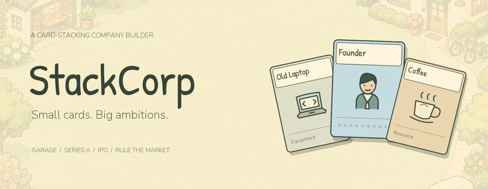
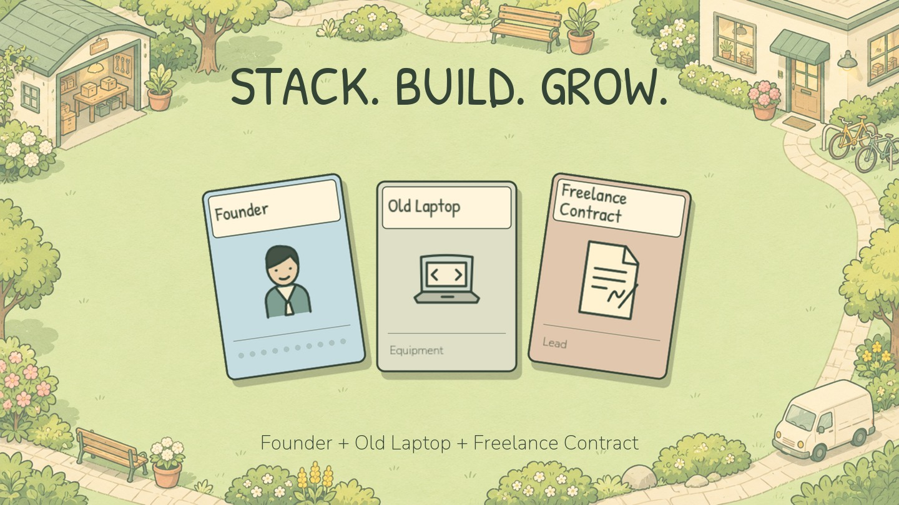
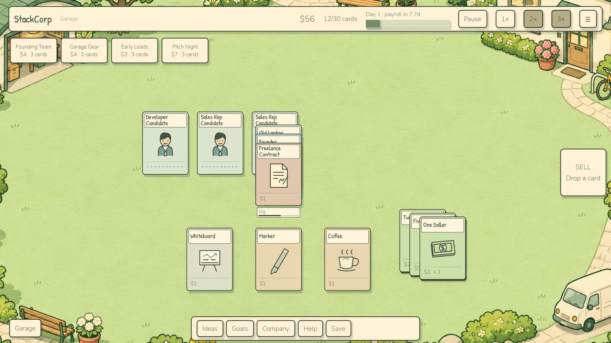
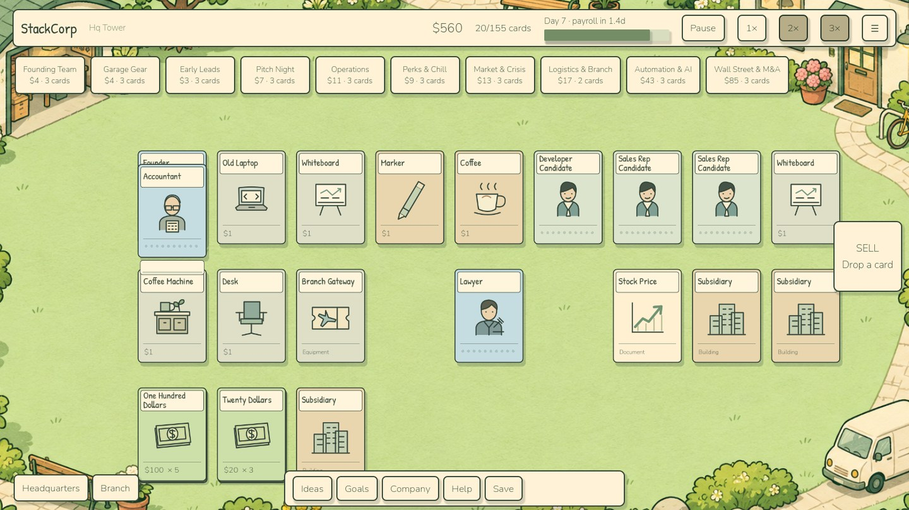

<div align="center">



**Một chiếc laptop cũ. Một người sáng lập. Cả một công ty chờ bạn xây dựng.**

Game mô phỏng xây công ty bằng cách kéo, thả và ghép thẻ.
Kiếm hợp đồng đầu tiên, phát triển sản phẩm, gọi vốn rồi tiến tới IPO.

<a href="https://github.com/longnee0108-ux/StackCorp/archive/refs/heads/main.zip"></a>

[Xem trailer](#trailer) · [Chơi ngay](#chơi-trên-windows) · [Hướng dẫn đầy đủ](docs/PLAY_GUIDE.md)

**Chơi đơn** &nbsp; / &nbsp; **Offline sau lần chuẩn bị đầu tiên** &nbsp; / &nbsp; **Giao diện English**

</div>

## Trailer

**20 giây từ chiếc bàn nhỏ đến tham vọng lớn.** Bấm Play và bật âm thanh.

https://github.com/user-attachments/assets/a84b5554-b537-40a5-8c84-a1615d2cba93

## Công ty của bạn nằm trên những tấm thẻ



**Kéo thẻ vào nhau để bắt đầu làm việc.** Ghép **Founder + Old Laptop + Freelance Contract** để kiếm tiền từ hợp đồng đầu tiên. Từ đó, mở pack, thuê người và tìm cách kết hợp thẻ để tạo sản phẩm mới.

| Xây dựng | Xoay xở | Vươn lên |
| :--- | :--- | :--- |
| Ghép người, thiết bị và ý tưởng thành những stack làm việc. | Giữ tiền trả lương, xử lý hóa đơn và chăm nhân viên trước khi burnout. | Gọi vốn Series A, mở chi nhánh, IPO và thâu tóm đối thủ. |

> Bàn làm việc thì yên bình. Kỳ trả lương vẫn đang đến gần. May mà còn cà phê.

## Từ garage đến thị trường

<table>
<tr>
<td width="50%"></td>
<td width="50%"></td>
</tr>
<tr>
<td><strong>Bắt đầu nhỏ.</strong><br>Một hợp đồng, một stack, rồi thêm một đồng đội.</td>
<td><strong>Nghĩ lớn hơn.</strong><br>Công ty niêm yết, nhiều văn phòng và những thương vụ thâu tóm.</td>
</tr>
</table>

**Garage → Series A → IPO → Rule the Market**

Chọn **Easy, Medium hoặc Hard**. Khi cần suy nghĩ, nhấn **Space** để tạm dừng: bạn vẫn có thể sắp thẻ và giao dịch. Có **Tutorial**, autosave và **Continue** để quay lại công ty của mình.

## Chơi trên Windows

1. **[Tải source ZIP](https://github.com/longnee0108-ux/StackCorp/archive/refs/heads/main.zip)** và giải nén toàn bộ thư mục.
2. Bấm đúp **`Play.cmd`**. Lần đầu cần Internet để launcher tải Godot portable chính thức và chuẩn bị tài nguyên; các lần sau có thể chơi offline.
3. Chọn **Tutorial** để làm quen, hoặc chọn độ khó rồi bấm **Play — start your company**.

Không cần cài Godot trước. Launcher tự chuẩn bị runtime phù hợp và kiểm SHA-512 của bản tải xuống. Không cần tài khoản hay API key.

<details>
<summary><strong>Điều khiển nhanh</strong></summary>

| Thao tác | Điều khiển |
| :--- | :--- |
| Di chuyển / ghép thẻ | Kéo chuột trái và thả lên thẻ phù hợp |
| Tách thẻ | Shift + kéo |
| Xem thẻ và hành động | Click hoặc chuột phải |
| Di chuyển góc nhìn | Giữ chuột giữa và kéo |
| Phóng to / thu nhỏ | Con lăn |
| Trở về giữa bàn | Home |
| Pause / tiếp tục | Space |
| Tốc độ | 1 / 2 / 3 |
| Ideas / Goals | I / G |
| Lưu / Menu | F5 / Esc |

Mua pack ở dải phía trên; bán bằng cách thả thẻ vào **Sell**. Music và Sound effects có thể bật/tắt riêng trong Settings.

</details>

<details>
<summary><strong>macOS, Linux và Godot Editor</strong></summary>

Dùng Godot standard **4.6.1 trở lên trong dòng 4.x**, mở `project.godot` rồi bấm **F5**. `Play.sh` dùng Godot có sẵn trên PATH; bootstrap tải runtime tự động hiện dành cho Windows.

Trên Windows, có thể dùng **`Editor.cmd`** để mở editor. Không cần export templates để chơi từ source.

</details>

<details>
<summary><strong>Save và dữ liệu của bạn</strong></summary>

Game lưu save và tùy chọn trong thư mục dữ liệu người dùng của Godot, tách khỏi source. Có autosave và Continue. Bấm New company khi đang có run sẽ yêu cầu xác nhận trong game.

Source trên GitHub không chứa save của người phát triển. [Đọc hướng dẫn đầy đủ](docs/PLAY_GUIDE.md).

</details>

<details>
<summary><strong>Dành cho người phát triển và tester</strong></summary>

**Godot 4.6.1 standard · GDScript · Compatibility renderer.** Không dùng plugin hoặc package ngoài trong game.

```sh
godot --headless --path . --editor --import
godot --headless --path . --script tools/scenario_test.gd
```

Backend ở `src/backend`; frontend ở `src/frontend` và `scenes`; nội dung, balance và English strings ở `data`; tài nguyên được đóng gói trong `assets`.

Mục tiêu tỷ lệ thắng Easy/Medium/Hard là **80/50/30%**; đây là mục tiêu balance, chưa được xác nhận bằng mẫu người chơi. Dùng kiểm tra tình huống tập trung thay cho chạy hàng nghìn bot mặc định.

[Kế hoạch triển khai](docs/IMPLEMENTATION_PLAN.md) · [Nghiệm thu](docs/ACCEPTANCE.md) · [Nguồn art & font](docs/ART_SOURCES.md) · [Quyết định thiết kế](DECISIONS.md)

Spec gốc giữ nguyên trong `StackCorp_Spec`; yêu cầu trong chat của người dùng được ưu tiên. Checklist tester nằm trong [hướng dẫn đầy đủ](docs/PLAY_GUIDE.md#checklist-tester).

</details>

---

<div align="center">

**Small cards. Big ambitions.**

Xây công ty của bạn. Nhớ để dành tiền lương — và một ly cà phê.

</div>
